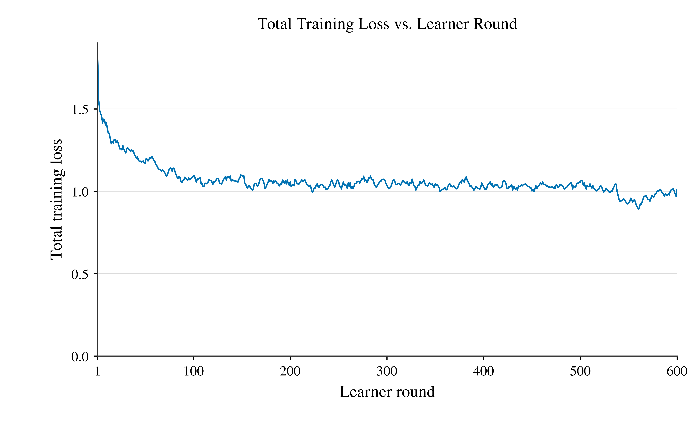
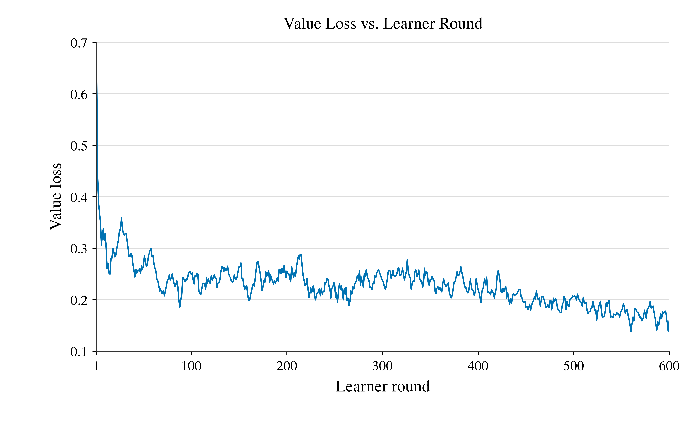
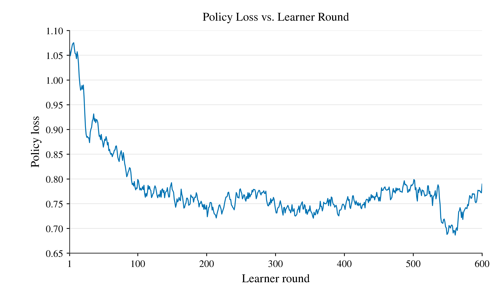
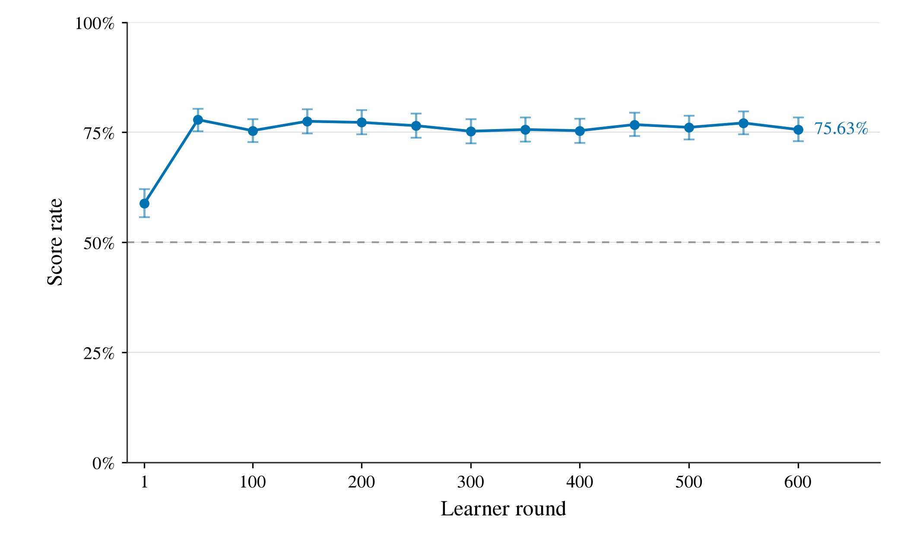
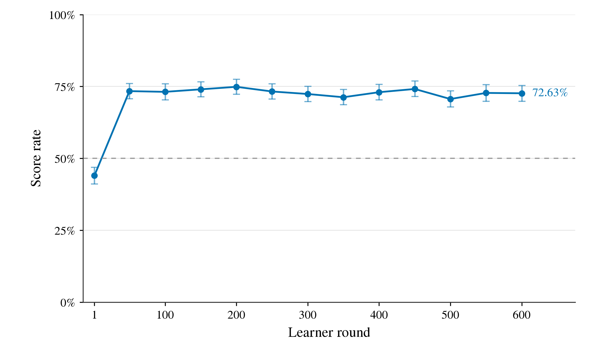
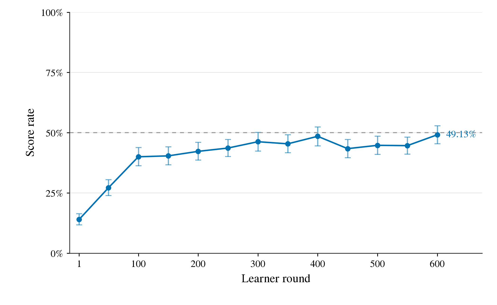

# AlphaAyoOlopon

AlphaAyoOlopon is a reinforcement learning project that learns to play Ayo Olopon, the Yoruba "game of the intellectuals," directly through self-play. We train a 185,863-parameter MLP with a policy head that predicts moves and a value head that estimates game outcomes. Trained checkpoints are evaluated against MCTS agents, depth-6 minimax, capture-only greedy, Greedy EoH H* and earlier neural checkpoints. The repository retains classical benchmarks against random play.

[AlphaGo Zero](https://deepmind.google/blog/alphago-zero-starting-from-scratch/) learned Go from self-play without human game examples, combining a policy/value network with Monte Carlo tree search. This project applies the same training idea to Ayo using an AlphaZero-style MLP.

## Checkpoint Metadata

C600 metadata from the [training manifest](docs/results/mlp600_training/training_manifest.json) and [training summary](docs/results/mlp600_training/training_summary.json).

| field                     |  value |
| ------------------------- | -----: |
| completed self-play games | 63,563 |
| completed learner rounds |    600 |
| model type                |    MLP |
| hidden size               |    256 |
| hidden layers             |      3 |
| training simulations      |     64 |
| replay capacity           | 16,384 |

## Training losses: 600 learner rounds



Total loss combines policy loss, value loss and weight-only L2 regularization.



Value loss is mean squared error against final game outcomes.



Policy loss is cross-entropy against self-play MCTS targets. These are recorded mean minibatch losses without smoothing; value and policy axes start above zero. Losses measure replay fitting. [Combined version and source data](visualizations/figures/mlp600_training_losses/README.md).

## Playing-strength progression

Each point represents 400 games from the same 200 paired openings, with draws scoring half a win. Bars show pointwise 95% opening-pair bootstrap intervals; lines connect measured checkpoints without smoothing. All checkpoints come from the same training run.



Neural PUCT with 64 simulations per move against the frozen Greedy EoH H* agent.



Neural PUCT with 64 simulations per move against uniform MCTS with 64 simulations.



Policy-only play against MCTS 64 shows strength without neural search. [Progression results and plotted values](visualizations/figures/checkpoint_progression/README.md).

## C600 evaluation

Each comparison uses the same [200 frozen DATASET ≤4 CAPTURE openings](experiments/checkpoint_strength/dataset/dataset_le4capture_v3_200.json), played from both seats: **400 games**. Evaluations use the Python/OpenSpiel adapter, a 1,000-action horizon with remaining-seed collection, and paired seeds. Neural PUCT uses constant 1.5, no root noise or temperature sampling; policy-only play chooses the highest-probability legal move.

W-D-L reports C600's wins, draws and losses. Score = `(wins + 0.5 * draws) / games`. Simulation budgets are per move; 0 means policy-only, and an em dash means greedy play. Minimax uses search depth instead of a simulation budget. Intervals are 95% bootstrap intervals from 10,000 resamples of whole opening pairs.

| Opponent | Games | C600 simulations | Opponent budget | C600 W–D–L | Win rate | Score rate | 95% score interval |
| --- | ---: | ---: | ---: | ---: | ---: | ---: | ---: |
| [Capture-only greedy](docs/results/c600_comparisons/c600_puct64_vs_capture_only_greedy/README.md) | 400 | 64 | — | 281–100–19 | 70.25% | 82.75% | 80.50%–85.00% |
| [Greedy EoH H*](docs/results/c600_comparisons/c600_puct64_vs_greedy_eoh_hstar/README.md) | 400 | 64 | — | 262–81–57 | 65.50% | 75.63% | 73.00%–78.38% |
| [Uniform MCTS](docs/results/c600_comparisons/c600_puct64_vs_mcts64/README.md) | 400 | 64 | 64 | 245–91–64 | 61.25% | **72.63%** | 69.88%–75.38% |
| [Uniform MCTS](docs/results/c600_comparisons/c600_puct64_vs_mcts128/README.md) | 400 | 64 | 128 | 232–99–69 | 58.00% | 70.38% | 67.75%–73.00% |
| [Uniform MCTS](docs/results/c600_comparisons/c600_policy_only_vs_mcts64/README.md) | 400 | 0 | 64 | 138–117–145 | 34.50% | 49.13% | 45.38%–52.88% |
| [C350 neural PUCT](docs/results/c600_comparisons/c600_puct64_vs_c350_puct64/README.md) | 400 | 64 | 64 | 153–106–141 | 38.25% | 51.50% | 49.00%–54.13% |
| [Minimax depth 6](docs/results/c600_comparisons/c600_puct64_vs_minimax_depth6/README.md) | 400 | 64 | depth 6 | 207-107-86 | 51.75% | 65.13% | 62.50% to 67.88% |

## Interpretation

Using 64 neural PUCT simulations per move, C600 achieves an **82.75% score rate against capture-only greedy** (**70.25% win rate**), **75.63%** against Greedy EoH H*, **72.63%** against MCTS 64, **70.38%** against MCTS 128—an opponent with twice its simulation budget—and **65.13%** against H* minimax at depth 6. The AlphaZero-style agent learned entirely from **63,563 self-play games**, without human game examples. These results show that the policy and value network learned through self-play can guide effective search and deliver strong performance against several different opponents on the evaluated openings.

From C350 to C600, total training loss improved slowly, decreasing from approximately **1.046 to 1.008**, while value loss also fell. Gains in playing strength were modest in the measured benchmarks. In their direct matchup, C600 scored **51.50%** against C350, with a 95% interval of **49.00% to 54.13%**, which includes an even score. Our limited compute budget and training duration leave the potential gains from longer training uncertain.

Further improvements could be explored by **increasing the model's parameter count**, **using a residual MLP**, or **training on more self-play games**. These experiments would help determine whether greater model capacity or more self-play experience can improve learning efficiency and playing strength.

For context, AlphaZero's Go training in the final 2018 study used **140 million self-play games**, compared with **63,563** in this Ayo run ([Silver et al., Table S3](https://storage.googleapis.com/deepmind-media/DeepMind.com/Blog/alphazero-shedding-new-light-on-chess-shogi-and-go/alphazero_preprint.pdf#page=27)). This much larger training scale provides a reason to explore longer self-play training here, while differences between the games and training setups limit direct comparisons of learning efficiency.

[Experiment reports and provenance](docs/results/README.md) | [Checkpoint progression figures](visualizations/figures/checkpoint_progression/README.md) | [Training loss figures](visualizations/figures/mlp600_training_losses/README.md) | [Classical search results](docs/results/classical_search/README.md)

## Install

Python 3.12+. Commands below use PowerShell; on Linux/macOS activate with `source .venv/bin/activate`.

```powershell
git -c core.longpaths=true clone --recurse-submodules https://github.com/davidprincehope/AlphaAyoOlopon.git
cd AlphaAyoOlopon
python -m venv .venv
.venv/Scripts/Activate.ps1
python -m pip install -r requirements-dev.txt
```

For an existing clone:

```powershell
git submodule update --init --recursive
```

## Play

Weights and raw runs are excluded from Git. Set `$run` to a compatible C600 run containing `manifest.json` and `inference-checkpoints/step-000600.npz`.

```powershell
$run = 'runs/alpha_zero/modal-a100-600-20261003'
python -B -m play --run $run --checkpoint 600 --simulations 64
```

[Gameplay guide](play/README.md)

## Train

Local pipeline check:

```powershell
python -m experiments.alpha_zero.train --dry-run
python -m experiments.alpha_zero.train --config experiments/alpha_zero/configs/smoke.json --output runs/alpha_zero/smoke
```

Train 600 rounds on Modal A100, then download the run:

```powershell
python -m modal setup
python -m modal run --detach experiments/alpha_zero/modal_train.py --background --config experiments/alpha_zero/configs/modal_a100.json --run-name mlp600 --max-steps 600
# After training completes:
python -m modal volume get alpha-ayo-alphazero-runs mlp600 runs/alpha_zero/mlp600
$run = 'runs/alpha_zero/mlp600'
```

[Training, local configuration and resume](experiments/alpha_zero/README.md)

## Evaluate

Use a compatible C600 `$run` and fresh output paths. Retrained checkpoints produce new results.

```powershell
python -m experiments.checkpoint_strength.neural_vs_mcts --run $run --config experiments/checkpoint_strength/configs/c600_vs_mcts_64.json --output runs/checkpoint_strength/c600-mcts64-rerun
python -B -m experiments.checkpoint_strength.neural_vs_minimax --run $run --config experiments/checkpoint_strength/configs/c600_puct64_vs_minimax_depth6.json --output runs/checkpoint_strength/c600-minimax-depth6-rerun --workers 8
python -m experiments.alpha_zero.offline_evaluate --run $run --config experiments/checkpoint_strength/configs/c600_vs_capture_greedy_64.json --output runs/checkpoint_strength/c600-capture-rerun/results.jsonl
```

[All comparison commands, paired evaluation and full suite](experiments/checkpoint_strength/README.md)

## Checks and figures

```powershell
python -B -m pytest tests -q
python -B scripts/check_repository.py --worktree
python -B -m visualizations.plot_checkpoint_progression
python -B -m visualizations.plot_state_space_growth
```

[Figure commands](visualizations/README.md), including training-loss regeneration from the original learner logs.

## OpenSpiel attribution

This project uses [OpenSpiel](https://github.com/google-deepmind/open_spiel), through the [Ayo fork](https://github.com/davidprincehope/open_spiel/tree/alpha-ayo-mlp-public), for its JAX/Flax AlphaZero learner and search algorithms. OpenSpiel is licensed under [Apache 2.0](open_spiel/LICENSE). Original copyright and license notices are retained; [third-party attribution and fork changes](THIRD_PARTY_NOTICES.md) describe the Ayo modifications.
